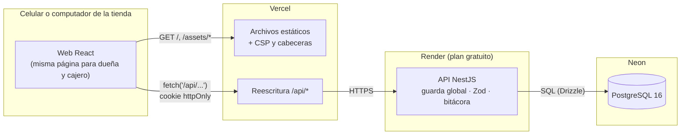
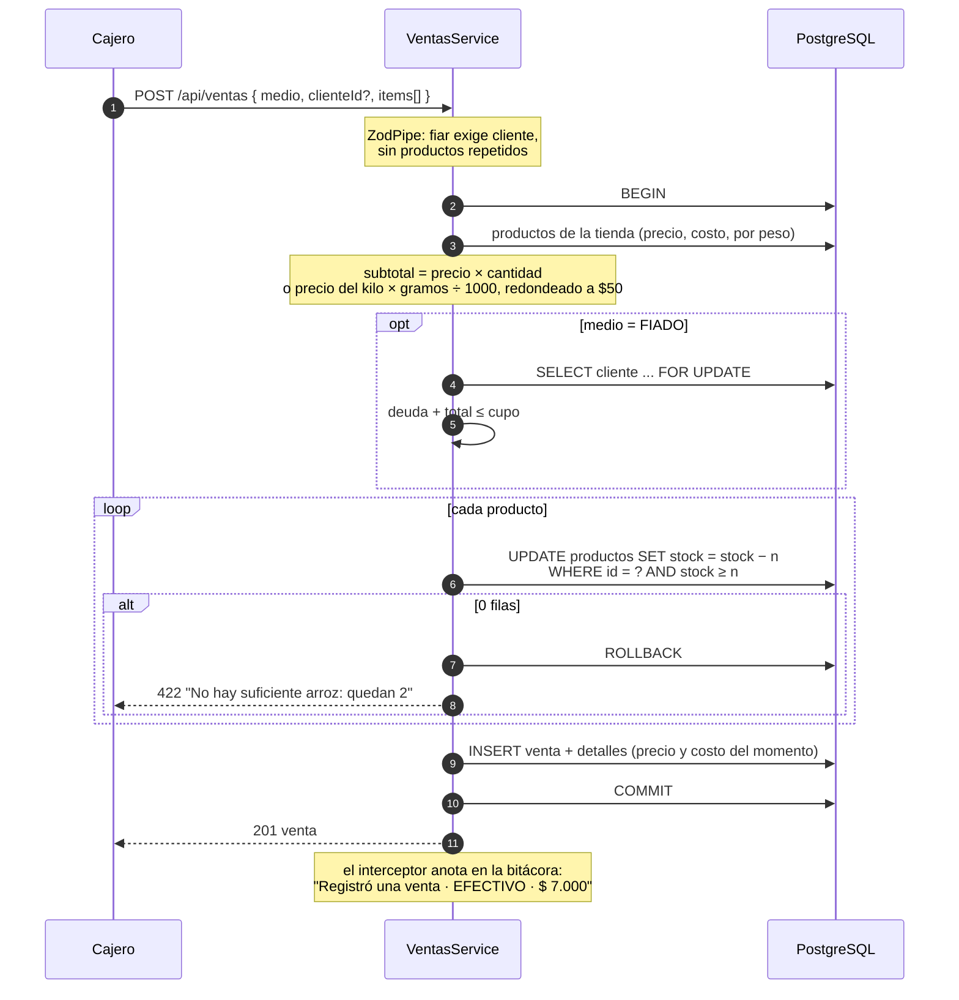
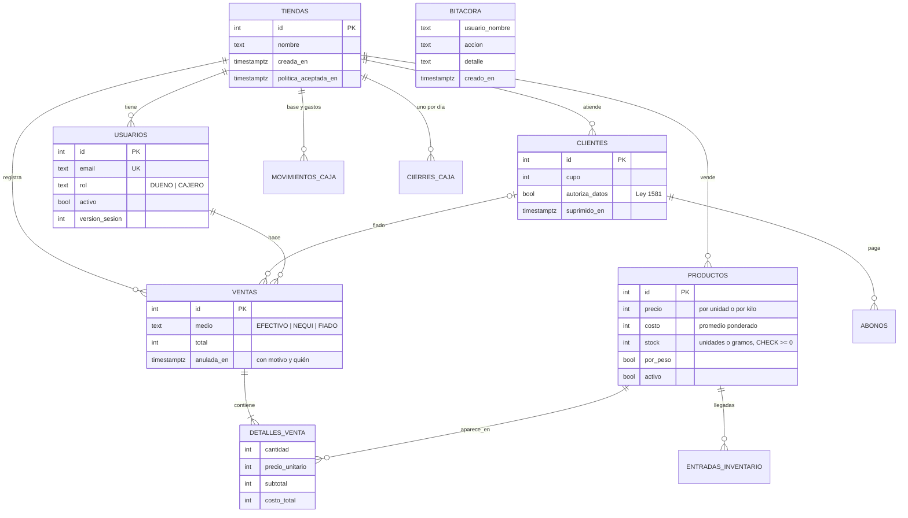
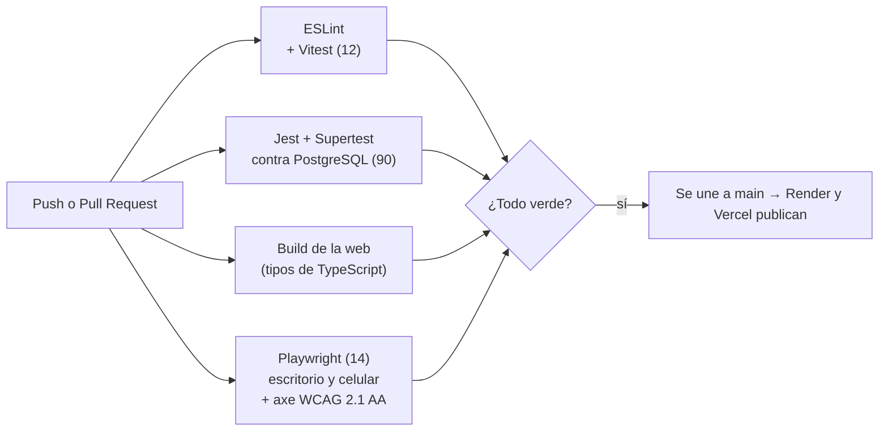

# Arquitectura de ElCuaderno

Cómo está armado el sistema y por qué. Las decisiones una por una están en [`decisiones.md`](decisiones.md); las historias de usuario y las reglas de negocio, en [`01-diseno.md`](01-diseno.md).

## 1. Las piezas y por dónde viaja una petición



- **La web y la API comparten dominio.** La web nunca llama a `onrender.com`: llama a `/api/...` en su propio dominio y Vercel la reenvía ([`vercel.json`](../apps/web/vercel.json)). Gracias a eso la cookie de sesión puede ser `SameSite=Strict` y no hace falta CORS en producción.
- **Un solo paquete de tipos.** `packages/shared` tiene los esquemas Zod y las funciones de dinero y peso. La web los importa del código fuente (alias de Vite) y la API los compila. Una regla, como "contraseña con letras y números" o "fiar exige cliente", se escribe una sola vez.
- **La demo se siembra al arrancar.** Render corre `migrar → sembrar → arrancar`. Así la "Tienda Doña Rosa" siempre amanece limpia, y de paso se borran las tiendas de prueba que la gente registró hace más de 7 días.

## 2. Sesión: cookie httpOnly y versión de sesión

```mermaid
sequenceDiagram
    autonumber
    participant N as Navegador
    participant G as Guarda global (NestJS)
    participant BD as PostgreSQL

    N->>G: POST /api/auth/login (correo, clave)
    Note over G: 5 fallos por correo en 15 min → 429
    G->>BD: usuario + tienda; bcrypt.compare
    G-->>N: Set-Cookie elcuaderno_sesion (HttpOnly, Secure, SameSite=Strict, 8 h)<br/>JWT con { sub, tiendaId, rol, v }

    N->>G: GET /api/productos (con la cookie)
    G->>G: verifica la firma del JWT
    G->>BD: SELECT activo, version_sesion FROM usuarios WHERE id = sub
    alt desactivado o v distinta
        G-->>N: 401 "Tu sesión se cerró"
    else vigente
        G->>G: revisa @Roles('DUENO') si la ruta lo pide
        G-->>N: 200 (solo datos de su tiendaId)
    end
```

- **JavaScript nunca ve el token.** Lo que la web guarda en `localStorage` es solo el nombre, el rol y la tienda, para pintar la pantalla mientras `/auth/yo` confirma la sesión.
- **Cerrar sesiones de verdad.** Un JWT normal vale hasta que vence, aunque el cajero ya se haya ido. Por eso cada usuario tiene `version_sesion`, que sube cuando la dueña lo desactiva, le pone una clave temporal o él mismo cambia su clave. La guarda compara esa versión en cada petición (una consulta por llave primaria), y el token viejo deja de servir de inmediato.
- **Aislamiento entre tiendas.** Cada consulta filtra por el `tiendaId` que viene en el token, nunca por uno que mande el navegador. Hay pruebas que intentan leer y modificar datos de otra tienda y esperan 404.

## 3. Una venta, paso a paso



- **Sin sobreventa.** El `WHERE stock >= n` hace que la base decida: si dos cajeros venden la última unidad al mismo tiempo, solo una fila se actualiza. Una prueba lanza 5 ventas simultáneas de la última unidad y verifica que solo una gana.
- **El cupo no se salta.** El `FOR UPDATE` sobre el cliente hace que dos fiados o abonos simultáneos se esperen el uno al otro.
- **El pasado no cambia.** El detalle guarda precio, costo, subtotal y costo total del momento. La caja y los reportes suman esas columnas, así que subir un precio hoy no altera la ganancia de ayer.

## 4. Modelo de datos



Reglas que vive en la base (además de las del código), para que ni un error de programación las rompa:

| Tabla | Restricción |
|---|---|
| `productos` | `stock >= 0`, `precio > 0`, `0 <= costo <= precio` |
| `ventas` | un fiado siempre tiene cliente; la anulación guarda fecha, quién y motivo, las tres o ninguna |
| `movimientos_caja` | una sola base por tienda y día (índice único parcial); un gasto siempre tiene concepto |
| `cierres_caja` | un cierre por tienda y día |
| `bitacora` | sin llaves foráneas (sobrevive al usuario) y un trigger impide `UPDATE` y `DELETE`; solo la recarga de la demo, dentro de su transacción, la puede vaciar |

La **deuda** de cada vecino no es una columna: se calcula como fiados no anulados menos abonos, con subconsultas. Nunca queda desincronizada.

## 5. Módulos de la API

| Módulo | Qué hace |
|---|---|
| `auth` | login, registro de tiendas, cambio de clave, guarda global (`@Publico`, `@Roles`), límites de intentos y de registros |
| `usuarios` | equipo de la tienda: crear cajeros, desactivarlos, clave temporal |
| `productos` | catálogo, llegadas de mercancía con costo promedio, venta a granel |
| `clientes` | vecinos, cupos, abonos y supresión de datos (Ley 1581) |
| `ventas` | venta atómica y anulación (solo de hoy, sin dejar saldo a favor) |
| `caja` | caja del día, base, gastos, cierre y reportes por rango |
| `bitacora` | interceptor que anota cada cambio que salió bien y su consulta paginada |
| `comun` | `ZodPipe`, `IdPipe`, errores de negocio (422) y filtro de errores inesperados |

## 6. Calidad: qué revisa el CI en cada cambio



- **Jest** levanta la app completa contra un PostgreSQL real, no contra simulaciones. Así prueba los `CHECK`, los bloqueos `FOR UPDATE`, el trigger de la bitácora y las zonas horarias.
- **Playwright** usa la app compilada, como en producción, con la API sembrada con la demo. Recorre lo que haría una persona: entrar con las notas adhesivas, vender, registrar una tienda, crear un cajero y desactivarlo.
- **axe-core** revisa la accesibilidad de todas las pantallas. Ya encontró y se arreglaron un rojo y un gris con poco contraste, botones sin nombre en el celular y una gráfica sin foco visible.
- **Dependabot** propone cada semana las actualizaciones, y cada una pasa por este mismo CI antes de unirse.

## 7. Límites conocidos (y qué haría después)

- **La API duerme.** En el plan gratuito de Render se apaga tras un rato sin uso y la primera petición tarda cerca de un minuto. La pantalla de acceso lo avisa. En producción real iría en un plan siempre encendido.
- **Límites en memoria.** Los contadores de intentos de login y de registros viven en la memoria del proceso. Con una sola instancia funciona; con varias, irían a la base de datos o a Redis.
- **Sin facturación electrónica** (DIAN) ni pagos en línea: están fuera del alcance a propósito.
- **Sin modo sin conexión.** Si se cae el internet en la tienda, no se puede vender. Una PWA con cola de ventas pendientes sería el siguiente paso grande.
